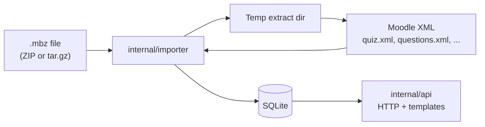

# Architecture

## Overview

1. **Import:** `ImportMBZ` detects archive format, extracts to a temporary directory, then `ImportBackupDir` walks Moodle backup layout, parses XML, and upserts into SQLite (after clearing prior quiz-related rows so one import equals one consistent snapshot).
2. **Serve:** `api.Server` registers routes on `http.ServeMux` (Go 1.22+ path patterns), loads quizzes with GORM preloads, and renders embedded HTML or JSON.

## Packages

### `internal/importer`

- Entry points: `ImportMBZ`, `ImportBackupDir`.
- Handles ZIP and gzip-compressed tar extraction.
- Coordinates parsing from `internal/moodle` and persistence via GORM models.

### `internal/moodle`

- Parses backup XML (e.g. `moodle_backup.xml`, activity `quiz.xml`, `questions.xml`).
- `BuildPayloadJSON` maps question XML to a compact JSON representation per question type where supported; unknown types still store `RawXML` and a minimal `"unsupported": true` payload marker.

### `internal/model`

- Defines tables for courses, quizzes, slots, sections, questions, feedbacks, grades, attempts, statistics, and local `PracticeAttempt` rows.
- `AllModels()` ordering respects foreign keys for `AutoMigrate`.

### `internal/db`

- Opens SQLite with shared cache and foreign keys; runs `AutoMigrate` on all models.
- `EnsureDir` creates parent directories for file DSN paths.

### `internal/api`

- Embeds `templates/*.html` via `embed.FS`.
- List and detail endpoints support HTML and JSON negotiation.

## Data flow (read path)

For `GET /quizzes/{id}`:

1. Load `Quiz` by primary key.
2. Preload `Slots` (ordered by slot), each slot’s `Question`, `Sections`, `Feedbacks`.
3. Render `quiz.html` with template helpers (e.g. `safeHTML` for stems, flags for unsupported types) or serialize the same graph to JSON.

## Extension points

- **New question types:** extend `BuildPayloadJSON` in `internal/moodle/qtype_payload.go` and, if needed, the quiz template for interactive rendering.
- **Alternative databases:** would require replacing `gorm.io/driver/sqlite` and reviewing SQLite-specific DSN and `AutoMigrate` behavior.
